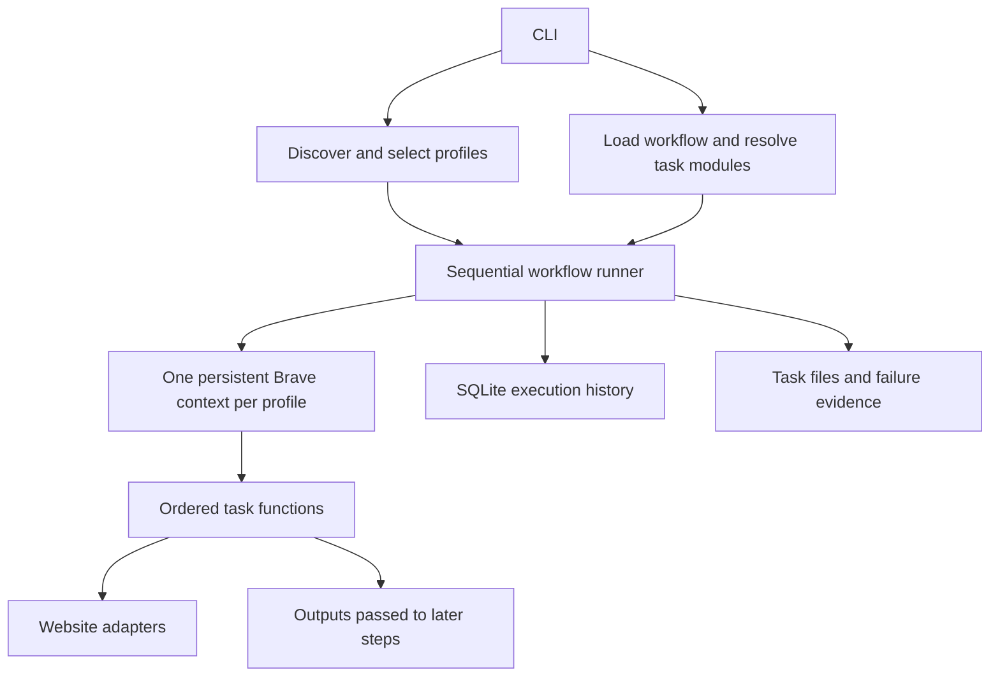

# Zepuppeteer

Zepuppeteer runs reusable **Python + Playwright web automations across groups of
persistent Brave profiles**. Each profile keeps its own cookies and website
sessions. A workflow opens one profile, executes its ordered tasks across the
required websites, records the results, closes Brave, and continues to the next
profile.

The project uses the Brave executable installed on your machine, controlled over
a local pipe. No separate Playwright browser download or exposed debugging port
is required. The included workflow operates on a local HTML page so the complete
pipeline can be tested without a website account or network connection.

## Quick start

Requires Python 3.10+ and a normal desktop user account. Run these commands from
the repository root:

```bash
# Native dependencies, including WireGuard VPN checks (Ubuntu/Debian).
sudo apt-get update
sudo apt-get install -y curl ca-certificates wireguard-tools iproute2 util-linux procps

python3 -m venv .venv
source .venv/bin/activate
python -m pip install -e .

mkdir -p profiles/account-1/src profiles/account-2/src
cp examples/profile.toml prVofiles/account-1/profile.toml
cp examples/profile.toml profiles/account-2/profile.toml

# Inspect exactly which profiles and tasks would run.
python -m zepuppeteer run --group demo --workflow demo --dry-run

# Execute the local demo without opening visible browser windows.
python -m zepuppeteer run --group demo --workflow demo --headless

# Inspect persisted results.
python -m zepuppeteer history
```

Alternatively, use `uv sync --locked`, then prefix commands with `uv run`.
`uv.lock` pins dependencies. Python 3.10 uses `tomli` for TOML parsing; newer
If Brave is missing, execution can install it through its official Ubuntu/Debian
APT repository using sudo. The installer needs network access and may prompt for
your sudo password. It also installs `wireguard-tools` and `iproute2` for VPN
checks. If Brave is already installed, use the native dependency commands above
to add these tools. Pass `--no-install` to fail instead, or
`--executable /path/to/brave-browser` to select an existing executable. Do not run
the application itself as root. Headless execution needs no desktop display;
visible execution requires DISPLAY or WAYLAND_DISPLAY.

Automated launches start the selected Brave profile with a blank page instead of
restoring previous or pinned tabs. Before launch, its startup preference is set
to New Tab and the pinned-tab startup list is cleared; cookies and saved logins
are retained. Original preferences are saved once beside `Preferences` as
`Preferences.before-zepuppeteer-startup`. This startup setting also applies to
subsequent manual launches of that profile. Close Brave before running a workflow.

### Brave crashes on a missing GNOME settings key

If startup reports `TargetClosedError` together with `font-antialiasing` or
`Settings schema ... does not contain a key named 'antialiasing'`, Brave has
crashed while initializing its Linux desktop UI, before workflow tasks run.
A Python environment or packaged terminal can expose incompatible GNOME schemas.
On Linux, the launcher uses `/usr/share/glib-2.0/schemas` for Brave when its
compiled schema cache exists. This changes only the browser's environment and
preserves the display and desktop session settings.

Retry the original command after updating the code:

```bash
python -m zepuppeteer run --workflow colab --profile acc-5
```

## Moving this codebase to a server

Use this checklist when moving from the development desktop to an Ubuntu/Debian
server. There is no patched Brave binary to copy: the browser changes below are
implemented in the Python launcher and are applied on the server at execution
time. Browser profiles, login sessions, credentials, and OS services still need
separate setup.

### 1. Transfer the source and account configuration

Copy or commit the latest source, `pyproject.toml`, `uv.lock`, and `config/`.
A Git clone only transfers committed files. Transfer these ignored files
separately when needed:

| Location | What to do on the server |
| --- | --- |
| `profiles/<id>/profile.toml` | Copy each account's configuration, including its Brave display name, Google login username, notebook URL, and notebook name. |
| `.env` | Recreate the Telegram bot token and destination chat, or set environment variables instead. Keep the real credentials out of Git. |
| `~/.config/BraveSoftware/Brave-Browser/` | Recreate the named profiles on the server, or transfer browser data separately as described below. This directory is outside the repo. |
| `profiles/<id>/src/` | Transfer only when using managed local browser data instead of `brave_browser_displayName`. |
| `data/` and `artifacts/` | Optionally copy execution history and evidence after stopping active workflows. Old history may contain paths from the previous machine. |

Rebuild `.venv` on the target; do not copy the desktop's virtual environment.
Use the server account's own home directory rather than paths under the desktop
user's home. The account must own and be able to write its profiles, history,
artifacts, and browser preferences.

### 2. Install the runtime and Brave

Use a regular, non-root account for running the application. Install Python 3.10+
and the native stable Brave package using
[Brave's official Linux instructions](https://brave.com/linux/). Install Brave
before unattended deployment; the launcher's automatic installer uses sudo and
may prompt interactively.

From the copied repository root, recreate the Python environment:

```bash
sudo apt-get update
sudo apt-get install -y curl ca-certificates wireguard-tools iproute2 util-linux procps
python3 -m venv .venv
source .venv/bin/activate
python -m pip install -e .
brave-browser --version
```

Alternatively, install `uv` on the server and run `uv sync --locked`. A separate
`playwright install` browser download is not needed: this project uses installed
Brave. Use `--executable /path/to/brave-browser` if it is not discoverable on PATH.

### 3. Recreate or transfer the correct Brave profiles

With `brave_browser_displayName` configured, discovery looks in the **server
account's** `~/.config/BraveSoftware/Brave-Browser/Local State`. It does not use
the copied repo's `src/` browser data for that account. Create a Brave profile
with the exact configured display name, such as `AI-acc5`; the internal folder
may be `Profile 1`, `Profile 2`, or another number on the new machine. The code
resolves the name automatically. Keep `acc-5` as the repository folder ID.

If transferring browser data, close Brave and stop workflows on both machines
before taking a backup/copy. Preserve the user-data root's `Local State` together
with the selected internal profile directories. Exclude the machine-specific
`SingletonLock`, `SingletonSocket`, and `SingletonCookie` files from the copy;
a copied lock referencing the old hostname can block startup. Never remove locks
from a browser that is still running. Do not merge a copied profile over a live
or unrelated server profile.

**Copying the profile directory does not guarantee that Google login sessions
will work on another machine.** The launcher preserves Brave's normal password
store selection, but it does not transfer, create, or unlock the desktop keyring.
Provide the appropriate keyring backend and user D-Bus session on the server,
and plan to log in interactively again if the copied session is unreadable or
expired. Chromium's backend selection and fallback behavior are documented in
[Linux Password Storage](https://chromium.googlesource.com/chromium/src/+/main/docs/linux/password_storage.md).
Do not add `--password-store=basic` or `--use-mock-keychain` as a migration workaround.

### 4. Browser changes applied automatically on the server

These behaviors are in `zepuppeteer/brave.py` and the runner; they do not need
to be recreated manually through Brave's settings UI:

| Change | Server behavior and persistence |
| --- | --- |
| Blank startup | Before launch, the selected profile's `Preferences` gets `session.restore_on_startup = 5`, `profile.exit_type = "Normal"`, and `pinned_tabs = []`. Previous/pinned tabs are not restored. Cookies and saved logins are retained. These preferences also affect later manual launches. |
| Preference backup | Before the first change, the original file is saved beside it as `Preferences.before-zepuppeteer-startup`. The server creates its own backup; later launches do not overwrite it. |
| Restore prompt | Launch arguments include `--no-first-run` and `--hide-crash-restore-bubble`. |
| Profile selection | The launcher passes the resolved user-data root and `--profile-directory` for the selected profile. |
| Desktop keyring | Playwright's `--password-store=basic` and `--use-mock-keychain` defaults are filtered out. The actual backend must still be available to the server user. |
| GNOME schema fix | On Linux, if `/usr/share/glib-2.0/schemas/gschemas.compiled` exists, the browser receives `GSETTINGS_SCHEMA_DIR=/usr/share/glib-2.0/schemas`. This applies only to the launched process; no system schema file is patched. Install the server's normal desktop schema packages if needed rather than copying the desktop's compiled cache. |
| Chromium sandbox | It stays enabled. Run as a normal user on a host that permits sandboxed Brave; do not run the workflow with sudo. |
| Browser setup | The context installs the `navigator.webdriver` override for documents and tolerates tabs/frames closing or navigating during startup. |

The selected browser data must be closed before launch. Profiles sharing a
user-data root must run sequentially; do not schedule overlapping processes for
that root. The project uses a local debugging pipe, so no inbound DevTools port
needs to be exposed.

### 5. Choose headless execution or provide an interactive desktop

For a server without a display, use `--headless` for workflow execution. For
initial Google login, MFA, runtime connection, or other manual attention, provide
an interactive desktop session, such as a remote desktop, and open Brave as the
same account that will run the workflow. A visible automated run needs a working
`DISPLAY` or `WAYLAND_DISPLAY`; setting the variable alone does not create a
display. Playwright also documents
[headed execution with Xvfb](https://playwright.dev/python/docs/browsers#running-headed).

A headless browser still needs access to the account's keyring/D-Bus session
when saved credentials depend on it. A cron or service process does not
automatically inherit the desktop session's environment. Configure the intended
user, home directory, repository working directory, environment, and writable
paths explicitly when adding a service. Scheduling is not built into this repo.

### 6. Configure Colab and Telegram, then verify the migration

The current Colab task reads these account-specific keys from
`profiles/acc-5/profile.toml`:

```toml
[profile]
brave_browser_displayName = "AI-acc5"

[profile.platforms.colab]
login_username = "account@example.com"
notebook_url = "https://colab.research.google.com/drive/YOUR_NOTEBOOK_ID"
notebook_name = "your-notebook.ipynb"
auto_connect = true
job_start_timeout_seconds = 300
```

Use the actual Google account and exact notebook name shown by Colab. The current
login/runtime selectors expect English account/connection labels. A connected
Colab runtime is remote service state, not a local Brave preference that can be
copied. The task checks the selected account, notebook name, and runtime
connection. With `auto_connect = true`, it opens Additional connection options,
selects Connect to a hosted runtime, and waits up to 300 seconds for a connection.
An already connecting runtime is given time to finish without another request.
Once connected, it clicks Run all and waits for the last code cell to start
executing. Resolve `NeedsAttention` in the server's interactive session and
retry as needed.

Recreate `.env` at the copied repository root:

```dotenv
telegram_bot_token="your-bot-token"
telegram_chat_id="your-chat-id"
```

Alternatively, set `TELEGRAM_BOT_TOKEN` and `TELEGRAM_CHAT_ID` for the server
process; these override `.env`. Allow outbound HTTPS to Telegram and the Google
services used by Colab. Copy any required proxy environment settings separately;
they are not supplied by the browser profile. A task's `NeedsAttention` sends an
alert with its profile, platform, and description. Look for
`Telegram alert accepted (message ID: ...)` in the terminal; HTTP/network errors
are reported separately without replacing the task failure.

Run these checks from the server repository root:

```bash
source .venv/bin/activate
python -m zepuppeteer profiles --profile acc-5
python -m zepuppeteer run --workflow colab --profile acc-5 --dry-run
python -m zepuppeteer run --workflow colab --profile acc-5 --headless
python -m zepuppeteer history
```

Confirm discovery reports the server's intended `user_data_dir`, internal
`profile_directory`, and `browser_display_name`. Dry run validates discovery and
the workflow plan; it does not prove login, keyring access, runtime connection,
or Telegram delivery. Verify a real run and inspect Telegram and failure evidence
before enabling unattended execution.

## Architecture

The main concepts are deliberately separate:

| Concept | Responsibility | Example |
| --- | --- | --- |
| Profile | Stable account identity, browser data, tags, settings | `account-1` |
| Group | Named collection of profile directory names | `demo` |
| Website adapter | A site's selectors, login checks, and navigation | `websites/demo.py` |
| Task | One operation with a verified result | `demo.fill_form` |
| Workflow | Ordered steps, inputs, parameters, and execution rules | `config/workflows/demo.toml` |
| Runner | Browser lifecycle, timeouts, retries, failure isolation | `runner.py` |
| State store | Durable run, profile, and step results | `data/runs.sqlite` |



The execution sequence is:

1. Discover profiles, read optional metadata, and apply the selection filters.
2. Parse the workflow and validate step IDs, dependencies, timeout values, retry
   declarations, task modules, and async function signatures.
3. In a dry run, print the plan and exit before creating history, artifacts, or a
   browser. Task modules are imported during validation, so keep module-level code
   free of side effects. Configuration and task code are trusted local inputs.
4. Check the execution environment and locate or install Brave.
5. Create a history record with pending entries for every selected profile and
   step. Open a persistent browser context for the first profile.
6. Run its tasks in order, pass declared outputs to dependent steps, and commit
   each result to SQLite. All websites in that workflow use this same profile's
   browser context.
7. Close the browser, record the profile outcome, and continue according to the
   workflow's failure policy. Print a run summary when execution finishes.

Profile-specific differences belong in metadata. Website-specific selectors
belong in website adapters. Task functions perform the work; the runner owns
execution policy and browser cleanup. A task implementation is shared by every
profile that runs it.

## Repository layout

```text
config/
  groups.toml                  # Named profile selections
  workflows/
    demo.toml                  # Runnable two-step workflow
    colab.toml                 # Open and inspect Google Colab notebooks
    kaggle.toml                # Open and inspect Kaggle notebook editors
examples/
  profile.toml                 # Optional profile metadata template
  demo_task.py                 # Original single-file task example
zepuppeteer/
  __main__.py                  # python -m zepuppeteer entry point
  cli.py                       # Commands, validation, environment setup
  config.py                    # TOML reading and JSON compatibility checks
  models.py                    # Profile, Workflow, Step, TaskContext, TaskResult
  profiles.py                  # Browser data discovery and profile selection
  workflows.py                 # Workflow schema and task module resolution
  brave.py                     # Brave lookup, installation, launch options, init script
  runner.py                    # Workflow and legacy task execution
  notifications.py             # Telegram alerts for NeedsAttention failures
  state.py                     # SQLite history and read-only queries
  profile_transfer.py          # Existing verified profile import/export logic
  websites/
    demo.py                    # Selectors and interactions for the local demo
    colab.py                   # Colab navigation, readiness, and access checks
    kaggle.py                  # Kaggle navigation, readiness, and access checks
  tasks/
    demo/
      fill_form.py             # Submit a form; save and return a report
      verify_result.py         # Consume and verify the preceding task's report
    colab/
      open_notebook.py         # Open a notebook; save screenshot and metadata
    kaggle/
      open_notebook.py         # Verify a notebook's account, name, and session
scripts/                       # Profile transfer and password utility entry points
src/utils.py                   # Existing AES-GCM password helpers used by scripts
profiles/                      # Local account metadata and Brave data; ignored by Git
data/                          # Local SQLite history; ignored by Git
artifacts/                     # Local task output and evidence; ignored by Git
.env                           # Local Telegram credentials; ignored by Git
tests/                         # Unit tests and disposable-browser integration tests
pyproject.toml                 # Package, Python version, dependencies, console command
uv.lock                        # Resolved dependency versions
```

`profiles/`, `data/`, and `artifacts/` are runtime directories, created as needed.
Create profile metadata explicitly with `createProfile` or by copying the example
TOML; installing the project leaves existing profile metadata untouched.
Configuration files and examples live in this checkout; when running from another
working directory, supply the appropriate directory/path flags.

## Profiles and browser data

The recommended managed layout matches the import/export utilities:

```text
profiles/
  account-1/
    profile.toml               # Optional metadata
    src/                       # Brave user-data directory
      Local State              # Created by Brave or imported
      Default/                 # Or Profile N for an imported profile
  account-2/
    src/
```

After adding an account's information to `profiles/<id>/profile.toml`, initialize
its Brave profile and open it for manual login:

```bash
python -m zepuppeteer createProfile acc-5
# Preview paths without creating files or launching Brave:
python -m zepuppeteer createProfile acc-5 --dry-run
```

The command reads the existing TOML and preserves its contents. With
`profile.brave_browser_displayName`, it creates that named profile in the
installed Brave browser's user-data root if missing, or reopens the matching
profile if it already exists. Other Brave profiles and settings are preserved.
Without a display-name setting, it initializes or reopens the account's local
`src/` data. Existing flat browser data also keeps its original location.

Log in to the required websites in the browser, complete any MFA, then close the
browser to finish. Subsequent workflows using `--profile acc-5` reuse that browser
data. Websites can still expire sessions or require login again.

You can also pass a new account name. In that case, the command creates its folder,
a default `profile.toml` with enabled metadata and empty settings, and `src/` for
persistent Brave data. Add account-specific workflow settings to the generated
TOML before running workflows.

Use `--profiles-dir PATH`, `--executable PATH`, or `--no-install` as needed.
`create-profile` is an alias. This task requires a desktop display and a non-hidden
profile directory name. Existing account configuration and saved logins are
retained. Browser data stays in place if setup is interrupted or browser startup
fails. Run the same setup command again to finish logging in:

```bash
python -m zepuppeteer createProfile acc-5
```

For Python callers, `await createProfile("acc-5", profiles_dir="./profiles")`
from `zepuppeteer.tasks.createProfile` returns a `TaskResult` with the profile ID,
manifest path, and browser data directory after the browser closes. Profile
creation is a standalone setup task, performed before running workflows.

An empty `src/` is initialized by Brave on first execution. A profile metadata
file can also designate a new managed profile before `src/` exists. Folder names
are stable identifiers: `account-1` remains the profile's ID even if its browser
display name changes.

An optional `profile.toml` uses this schema:

```toml
enabled = true
tags = ["reports", "team-a"]

# Set this only when selecting an existing internal browser profile.
# profile_directory = "Profile 2"

[settings]
timezone = "Asia/Tehran"

[settings.portal_a]
base_url = "https://example.com"
username_env = "PORTAL_A_USERNAME"
password_env = "PORTAL_A_PASSWORD"
```

Tasks access the settings through `ctx.profile.settings`. Environment variable
names are ordinary configuration: a task must resolve them explicitly, for
example with `os.environ[settings["password_env"]]`. The framework does not log in
to websites automatically. Listing profiles and printing a dry-run plan omit
settings contents. Other metadata is left untouched.

For manual logins in an existing profile, launch regular Brave directly:

```bash
python -m zepuppeteer openProfile acc-5
# Print the resolved browser command without launching it:
python -m zepuppeteer openProfile acc-5 --dry-run
```

`openProfile` (alias `open-profile`) uses the account's existing browser data and
opens a normal Brave window. Log in to the websites you need, then close Brave
before running workflows. VPN-enabled profiles use their configured VPN for
the entire browser session, including manual logins; close all Brave windows
sharing that data root before opening one. For profiles without VPN routing,
an already-running instance can open the new window and return immediately.
Use `--profiles-dir PATH` or `--executable PATH`
as needed. Missing profiles or browser data must first be set up with `createProfile`.

To open a named profile from the installed Brave browser on Ubuntu, set:

```toml
[profile]
brave_browser_displayName = "AI-acc5"
```

The runner matches that exact display name in
`~/.config/BraveSoftware/Brave-Browser/Local State` and launches the corresponding
internal directory from that user-data root. With this setting, `--profile acc-5`
uses the installed named profile, including its existing sessions; `acc-5/src`
is not used. Missing or duplicate display names are errors, so an unrelated or
new profile is never silently selected. Close Brave before running automation
against its user-data root. Do not combine this setting with `profile_directory`.

When `src/` contains a single `Default` or `Profile N` folder, discovery selects
that internal browser profile automatically. This includes imported profiles that
use names such as `Profile 2`. If several internal profiles exist, set
`profile_directory` explicitly; a configured internal directory must already
exist. Ambiguous flat-plus-src layouts and symlinked browser roots are rejected.

The folder ID and Brave's displayed name are different identifiers: for example,
`--profile acc-5` with the setting above can select the installed `Profile 2`,
whose displayed name is `AI-acc5`. `Profile 2` is Brave's internal directory,
not account number 2. Without a display-name setting, the managed local data
described above remains the default.
Use `brave://version` to check the active **Profile Path**, or Brave Settings →
**Profile name and icon** to check the displayed name. The launcher preserves
Brave's desktop keyring so imported cookies and saved sessions remain readable;
Playwright's basic password store and mock keychain defaults are filtered out.

Two older layouts remain supported:

- **Flat isolated:** each immediate folder directly contains Brave's `Local State`
  and `Default`/`Profile N`, or is empty. Adding metadata to an initialized flat
  profile keeps its existing data location.
- **Native Brave root:** a root containing `Local State` is recognized automatically;
  its `Default` and `Profile N` folders become separate selectable profiles sharing
  that root. Pass the root, not an individual internal profile folder.

```bash
python -m zepuppeteer profiles --profiles-dir "$HOME/.config/BraveSoftware/Brave-Browser"
```

Use `--layout isolated` or `--layout native` to override root detection. Hidden and
symlinked profile folders are ignored. Discovery uses natural order, so
`account2` precedes `account10`. Close Brave instances using the selected data
before execution. The runner does not delete lock files or terminate unrelated
browsers. Native profiles share a data root and always execute sequentially.

## Groups and profile selection

`config/groups.toml` contains explicit profile directory names:

```toml
[groups]
demo = ["account-1", "account-2"]
reports = ["account-1", "account-3"]
```

The built-in group `all` selects all enabled profiles and does not require a group
configuration file. It is the default and its name is reserved. Named groups may
overlap. Unknown group names and missing group members fail before execution;
disabled members are excluded. Group declaration order does not override natural
profile discovery order.

```bash
python -m zepuppeteer profiles
python -m zepuppeteer profiles --names
python -m zepuppeteer profiles --group demo
python -m zepuppeteer profiles --include-disabled
python -m zepuppeteer run --workflow demo --group demo --profile account-1
python -m zepuppeteer run --workflow demo --tag reports --tag team-a
```

`--profile` and `--tag` are repeatable. Explicit names, group membership, and tags
are intersected; a profile must have every requested tag. An empty selection
produces an error instead of silently doing nothing. Use `--config-dir PATH` to
select another directory containing `groups.toml` and `workflows/`.

## Workflow configuration

A workflow name resolves to `config/workflows/<name>.toml`. You can also pass an
explicit TOML path with `--workflow ./somewhere/workflow.toml`.

```toml
name = "demo"
on_profile_failure = "continue"

[[steps]]
id = "submit"
task = "demo.fill_form"
timeout_seconds = 30
retries = 0

[steps.params]
prefix = "Hello "

[[steps]]
id = "verify"
task = "demo.verify_result"
input_from = "submit"
timeout_seconds = 10
```

| Field | Meaning | Default |
| --- | --- | --- |
| `name` | Workflow identifier | TOML filename stem |
| `on_profile_failure` | `continue` with the next profile, or `stop` the run | `continue` |
| `steps[].task` | Module below `zepuppeteer.tasks`, such as `demo.fill_form` | Required |
| `steps[].id` | Unique step identifier; required to distinguish repeated uses of one task | Task name |
| `steps[].params` | JSON-compatible task parameters | Empty table |
| `steps[].input_from` | Earlier step ID whose outputs become this step's inputs | No inputs |
| `steps[].timeout_seconds` | Positive timeout for each task attempt | `120` |
| `steps[].retries` | Additional attempts after the first failure | `0` |
| `steps[].retry_safe` | Explicit declaration that repeating this task is safe | `false` |
| `steps[].retry_delay_seconds` | Nonnegative delay between attempts | `1` |

Unknown workflow and step options are rejected to catch spelling mistakes.
Dependencies must point to earlier steps; execution follows the listed order.
Only the declared source's outputs are passed as inputs. Multiple steps may use
the same task with different IDs and parameters.

A retry declaration must include `retry_safe = true`. For example, a read-only
report lookup could use `retries = 2` and `retry_delay_seconds = 5`. For operations
that submit, publish, purchase, or upload, the task must verify the previous
outcome before repeating the action. The runner cannot infer whether a website
committed an operation before a connection failed. A timeout cancels the task's
Python coroutine; it cannot undo an action already accepted by a website.

## Google Colab task

`colab.open_notebook` is the first real-website task. Its implementation is
`zepuppeteer/tasks/colab/open_notebook.py`, with website navigation in
`zepuppeteer/websites/colab.py` and a ready-to-use workflow at
`config/workflows/colab.toml`.

For each selected profile it opens a notebook in a new tab, waits for the editor
and title, verifies the Google account and configured notebook name, and checks
that the notebook is connected to a runtime. With `auto_connect = true`, a
disconnected notebook uses Additional connection options → Connect to a hosted
runtime and waits up to 300 seconds for connected indicators. If a connection is
already in progress, it waits without submitting another request. With
`auto_connect = false` (the default), a missing connection requires attention.

After connection, the task clicks Run all once and waits for the last **code**
cell's running indicator, including when the runtime was already connected.
An earlier running cell, a queued final cell, and saved output are not accepted
as proof that the main job started. Existing running or queued cells cause
`NeedsAttention` before clicking, so a previous job is not restarted accidentally.
`job_start_timeout_seconds` controls this wait and defaults to 300 seconds.

The task then closes its tab; the runner closes the profile when its workflow
finishes. It confirms job startup, not completion, and does not maintain a browser
connection or guarantee the job continues after closure. The included Colab
workflow allows 900 seconds per attempt to accommodate navigation, verification,
runtime startup, and earlier cells reaching the final job. Increase the workflow
timeout as well if increasing the job-start wait beyond that budget.

```bash
python -m zepuppeteer run --workflow colab --dry-run
python -m zepuppeteer run --workflow colab --profile acc-5
python -m zepuppeteer run --workflow colab --profile acc-5 --headless
```

The current task reads its URL, account, and expected notebook name from this
table in the account's `profile.toml`:

```toml
[profile.platforms.colab]
login_username = "account@example.com"
notebook_url = "https://colab.research.google.com/drive/YOUR_NOTEBOOK_ID"
notebook_name = "your-notebook.ipynb"
use_vpn = false # Set true when profile VPN settings are configured.
auto_connect = true
job_start_timeout_seconds = 300
```

`use_vpn` defaults to `false`. When `true`, Brave is launched through the profile's
configured VPN before any notebook navigation, and the tunnel stays active until
Brave closes. Colab checks that same live tunnel before opening the notebook.
Missing tools, invalid settings, or failed connectivity raise `NeedsAttention`;
the browser is never retried through a direct connection. Configure the VPN as
described below.

`notebook_name` must match the title exactly, excluding the trailing ` - Colab`.
Use `notebook_url`, not the older `worker_url` key. The current implementation
does not use `params.notebook_url`, `settings.colab.notebook_url`, or a public
notebook fallback to select the URL; older template/workflow comments describing
those options do not apply to this version of the task. HTTPS Colab URLs are
accepted, including Drive/GitHub notebook paths, account-selection queries such
as `?authuser=1`, and cell fragments. Other hosts and URL credentials are rejected.

A sign-in/consent redirect, access restriction, blocking dialog, wrong/unverified
Google account, mismatched notebook name, unavailable connection menu, or runtime
that remains disconnected/unverified after the connection wait raises
`NeedsAttention`. The runner sends a Telegram alert when configured;
open the profile manually, resolve the prerequisite, close Brave, and retry.
Login is not automated. Editor readiness is based on structural roles and the
notebook title. Login and runtime checks use English UI labels; website UI
changes or a different language may require updating the selectors. The login
and initial runtime checks each wait up to 15 seconds; after requesting or
observing an in-progress connection with `auto_connect`, the runtime wait is up
to 300 seconds. If the last code cell never starts, the job-start wait also
raises `NeedsAttention`; inspect earlier cells for errors or input requests.
Blocking consent/quota dialogs or other manual prerequisites require attention;
the task does not automatically accept them.

The successful result has `status="success"` and outputs `job_started=true`
and `last_cell_id`. It does not produce a success screenshot or `notebook.json`.
The runner still collects screenshots, error details, and traces on failure.
Success verifies the account, notebook name, runtime connection, and that the
last code cell started executing; it does not verify the job's eventual result.

## Kaggle task

`kaggle.open_notebook` follows the Colab task structure: the task is in
`zepuppeteer/tasks/kaggle/open_notebook.py`, navigation is in
`zepuppeteer/websites/kaggle.py`, and `config/workflows/kaggle.toml` runs it.

Configure each account's `profile.toml` with:

```toml
[profile.platforms.kaggle]
login_username = "your-kaggle-username"
notebook_url = "https://www.kaggle.com/code/your-kaggle-username/your-notebook/edit"
notebook_name = "Your Notebook"
```

`login_username` is the Kaggle handle from your profile URL, rather than the
email used to sign in. The task verifies the account menu's profile link; a
notebook author's profile link is not proof of the active account. Notebook names
must match the page title exactly, excluding an optional ` | Kaggle` or
` - Kaggle` suffix. Use the displayed title, rather than the URL slug.

```bash
python -m zepuppeteer run --workflow kaggle --profile acc-5 --dry-run
python -m zepuppeteer run --workflow kaggle --profile acc-5
python -m zepuppeteer run --workflow kaggle --profile acc-5 --headless
```

The task reads those three values from `[profile.platforms.kaggle]`; it skips
profiles without that table. Workflow parameters and `settings.kaggle` do not
override them. HTTPS notebook URLs on `kaggle.com` and `www.kaggle.com` are
accepted, and a missing `/edit` suffix is added while preserving the query and
fragment. The configured account must already have access to the existing editor.
See [Kaggle's notebook documentation](https://www.kaggle.com/docs/notebooks) for
the service's notebook interface.

The task opens a new tab, waits for the editor's Save Version control and code
editor, then checks the account, notebook title, and running session. Sign-in or
verification, blocking dialogs, unsuitable account/name/session state, and
restricted access raise `NeedsAttention`, using the runner's existing Telegram
notification and failure evidence handling. It leaves the tab open on failure
and closes it on success, returning `status="success"` with `outputs={}`.

Login and session checks each wait up to 15 seconds and use English accessible
labels. Unrecognized UI returns an unverified state and requires attention.
These selectors have local DOM-fixture coverage; a signed-in Kaggle notebook
has not been used for end-to-end verification. The task does not sign in, start
sessions, edit or execute cells, or save notebook versions automatically.

## Profile VPN routing and connectivity checks

To require the configured VPN for every launch of a profile, add:

```toml
[profile]
use_vpn = true
```

`use_vpn = true` under `[profile.platforms.colab]` or another platform also
enables VPN routing when that platform runs in a workflow. Manual `openProfile`
and `createProfile` launches enable routing when any platform requires it.
The setting applies to the entire Brave session and all its tabs, not only the
platform's notebook tab. Set up the VPN credentials under `[profile.vpn]` as below.

VPN-enabled browsers run as your normal user inside their own Linux network
namespace. WireGuard is the only external interface in its namespace; IPv4 and
IPv6 destinations outside its configured routes are unreachable. DNS uses the
WireGuard configuration's numeric DNS servers, with a public resolver fallback
when none is specified. V2Ray uses a private bridge to Xray from a namespace
containing only loopback. Direct connections, proxy bypasses, QUIC, and WebRTC
cannot create an external route outside the configured VPN. A failed tunnel
leaves the browser disconnected.

The tunnel remains open for the browser's lifetime and is removed after the
browser exits. Host routes and host DNS settings stay unchanged. Existing Brave
instances using the same user-data root must be closed first, including other
native profiles sharing that root, so Chromium cannot hand the window to a
browser running outside the VPN. Linux, `ip`, `setpriv` (util-linux), and sudo
permission to create network namespaces are required for browser VPN routing.
Brave keeps its Chromium sandbox and is never run as root.

`vpnCheck` accepts a profile directory name and tests an HTTPS request through
that profile's VPN without opening Brave. This standalone diagnostic creates its
own temporary probe tunnel; it does not launch or reconfigure a browser:

```bash
python -m zepuppeteer vpnCheck acc-5
python -m zepuppeteer vpnCheck acc-5 --profiles-dir ./profiles --timeout 20
```

Add one of these configurations to `profiles/<account>/profile.toml`:

```toml
[profile.vpn]
vpn_protocol = "wireguard"
wireguard_file = "tunnel.conf"
```

```toml
[profile.vpn]
vpn_protocol = "v2ray"
v2ray_link = "vless://YOUR_ID@vpn.example.com:443?security=tls&type=ws&path=%2Fvpn"
```

The same keys directly under `[profile]` or at the top level are also accepted.
`wireguard_file` can be absolute or relative to the containing `profile.toml`.
The command exits with an error for missing tools, invalid settings, or failed
connectivity; it never installs software. Both protocols need `curl`. V2Ray
needs `xray` on PATH and supports VLESS, VMess, Trojan, and SIP002 Shadowsocks
share links. Supported transports are TCP/RAW, WebSocket, gRPC, HTTPUpgrade, and
XHTTP, with none/TLS/REALITY security as appropriate. Unsupported link formats,
TCP header obfuscation, Shadowsocks plugins, and links disabling TLS verification
are rejected. Xray validates the generated configuration before starting.

WireGuard needs Linux network namespaces, kernel WireGuard support, `wg`
(wireguard-tools), and `ip` (iproute2). A normal user also needs `sudo` access.
Terminal runs reuse cached authorization or show sudo's native password prompt
before creating any network resources. The preflight runs the read-only
`sudo -n ip netns list`, so command-specific passwordless sudo access works even
when `sudo -v` requires a password. You can also run `sudo ip netns list` in the
same terminal before retrying the command. Runs without a terminal never prompt and
need sudo authorization configured in advance. All subsequent privileged
commands use `sudo -n`.
Keys and peer endpoints are validated before sudo or network setup. Endpoint
hostnames are resolved using the host's DNS and passed to `wg` as numeric IPs;
DNS errors identify that prerequisite directly. If `wg setconf` fails, its
diagnostic is shown with WireGuard keys redacted.

The stripped WireGuard configuration is staged as a root-owned mode-600 file in
`/etc/wireguard`, which is allowed by Ubuntu's `wg` AppArmor policy. The task uses
the standard `mkdir`, `install`, and `rm` utilities for this. It removes the file
immediately after loading, and also attempts removal on failure or cancellation.

The task creates a temporary WireGuard interface, moves it into a disposable
namespace, and routes only the probe IP there. It leaves host routes and DNS
unchanged, ignores wg-quick shell hooks, and does not reuse existing VPN
interfaces. Configured ListenPort and FwMark are omitted to avoid host conflicts.
See WireGuard's [network namespace documentation](https://www.wireguard.com/netns/)
for the interface isolation mechanism.

The default probe is `https://1.1.1.1/cdn-cgi/trace`. Override it with `--url`;
WireGuard requires a numeric IP host covered by the configuration's AllowedIPs
and a matching IPv4/IPv6 interface address. This checks internet access through
the tunnel, so a private-network VPN may need its own reachable HTTPS endpoint.
The result prints total HTTPS request latency in milliseconds. WireGuard also
attempts three ICMP pings when `ping` is installed; blocked/missing ICMP does not
fail an otherwise successful HTTPS check. V2Ray reports HTTPS latency because
the SOCKS proxy does not carry ICMP ping.

Xray runs as a temporary process with an authenticated SOCKS listener on
127.0.0.1 and no direct outbound fallback. Its temporary configuration is private
and removed on exit. Temporary processes, interfaces, and namespaces are cleaned
up on success, failure, timeout, or cancellation. Credentials are not printed.
The generated configuration uses the official
[Xray transports](https://xtls.github.io/en/config/transport.html) and
[config validation command](https://github.com/XTLS/Xray-docs-next/blob/main/docs/en/document/command.md).

For Python callers, use `await vpnCheck("acc-5", profiles_dir="./profiles")`
from `zepuppeteer.tasks.vpnCheck`. It returns a `TaskResult` with `profile`,
`vpn_protocol`, `connected`, `latency_ms`, and optional `ping_ms`. Existing
browser workflows can include `task = "vpnCheck"`; the task reads the current
profile's manifest and accepts `timeout` and `url` in `[steps.params]`.

## Writing tasks and website adapters

To add a website, create its adapter under `zepuppeteer/websites/`, then create a
package under `zepuppeteer/tasks/<site>/` with an `__init__.py` and task modules.
Put reusable login checks, selectors, and navigation in the adapter. Use
Playwright's role/label locators and explicit result checks there. Keep workflow
failure policy and browser launching in the runner.

Every workflow task exposes this contract:

```python
from zepuppeteer.models import NeedsAttention, TaskContext, TaskResult
from zepuppeteer.websites.my_portal import MyPortal


async def run(ctx: TaskContext) -> TaskResult:
    # MyPortal is your site's adapter; implement these methods for the real site.
    settings = ctx.profile.settings["my_portal"]
    page = await ctx.browser.new_page()
    portal = MyPortal(page, base_url=settings["base_url"])
    await portal.open()
    if not await portal.is_logged_in():
        raise NeedsAttention("Log in to my_portal before running this profile.")
    report_path = await portal.export_report(
        period=ctx.params["period"], destination=ctx.artifact_dir
    )
    await portal.verify_report(report_path)
    await page.close()
    return TaskResult(outputs={"report_path": str(report_path)})
```

This example illustrates a custom adapter; `MyPortal` is not included. The working
reference is `tasks/demo/fill_form.py` together with `websites/demo.py`.

`TaskContext` provides:

- `browser`: the current profile's Playwright `BrowserContext`.
- `profile`: its name, browser data paths, enabled flag, tags, and settings.
- `params`: a fresh copy of this step's parameters.
- `inputs`: a fresh copy of the declared earlier step's output dictionary.
- `artifact_dir`: an existing, unique directory for this attempt's files.
- `run_id` and `step_id`: identifiers for diagnostics and saved outputs.

Return `TaskResult(outputs={...}, message="...")` after verifying success. Outputs
must be dictionaries containing JSON-compatible values; convert paths to strings.
Dates, bytes, NaN, and arbitrary Python objects are rejected. Return
`TaskResult(status="skipped", message="Nothing to export")` when there is no work.
Raise an exception on failure. `NeedsAttention` marks a manual prerequisite such
as an expired session or MFA and is never retried, even when retries are enabled.

When a workflow task raises `NeedsAttention`, the runner sends a Telegram alert
with the profile ID (and Brave display name when configured), platform, and
description. The platform is the first component of the task name, such as
`colab` for `colab.open_notebook`. Successful tasks and ordinary failures do not
send attention alerts.

Configure the bot in `.env` at the repository root:

```dotenv
telegram_bot_token="your-bot-token"
telegram_chat_id="your-chat-id"
```

`TELEGRAM_BOT_TOKEN` and `TELEGRAM_CHAT_ID` environment variables take precedence
over `.env`. Telegram requests have a 10-second network timeout and run outside
the async event loop. Notification failures are logged without changing the
original task failure. The `.env` file is ignored by Git.
Accepted sends print Telegram's message ID so delivery attempts are visible in
the terminal.

Tasks must await their work and cooperate with cancellation. Close task-owned
pages after success; leaving a failing page open lets the runner capture it.
The runner closes the whole context after the profile finishes. Tasks should not
close that shared context or launch a second instance of the same profile.

## Failures, history, and artifacts

A failed required step stops the current profile's workflow and marks its
remaining steps skipped. The default `continue` policy runs the next profile;
`stop` also marks unstarted profiles skipped. A task that deliberately returns
`skipped` skips later steps that require its output, while independent subsequent
steps may still run. A profile with no failed steps counts as successful even if
some or all steps were deliberately skipped.

Each attempt gets a directory under:

```text
artifacts/<run-id>/<profile>-<hash>/<step>-<hash>/attempt-1/
```

Filesystem components are sanitized and include a short hash to prevent name
collisions. Task files can be retained on success. Failed attempts also retain a
`failure.json` with the error and open-page URLs, screenshots of up to five open
pages, and a Playwright `trace.zip` when tracing is available. Browser launch/setup
errors are recorded at the profile directory. Evidence collection is best effort:
its failure does not replace the task's original error. Successful attempt traces
are discarded; `--no-trace` disables trace recording. Task timeouts cover the task
coroutine; launch, cleanup, evidence capture, and retry delays are separate.

SQLite stores three levels of history:

| Table | Recorded information |
| --- | --- |
| `runs` | Workflow name, run ID, status, UTC timestamps, artifact root |
| `profile_runs` | Each selected profile's status, timestamps, and failure |
| `step_runs` | Task/step IDs, status, attempt count, latest attempt directory, outputs, message, error |

Writes are committed after each transition. A step row holds its final result and
attempt count; earlier failed attempts remain in their artifact directories.
Run statuses are `running`, `success`, `failed`, or `cancelled`. Profile/step
entries also use `pending` and `skipped`. Summary `skipped` counts unstarted
profiles; inspect step details for individual skipped tasks.

```bash
python -m zepuppeteer history --limit 10
python -m zepuppeteer history --run-id RUN_ID
python -m zepuppeteer history --state-db /path/to/runs.sqlite
python -m zepuppeteer run --workflow demo --state-db ./data/demo.sqlite --artifacts-dir ./artifacts
```

History opens an existing database read-only. An absent database returns an empty
history list. A normal run exits with status 0 when selected profiles succeed and
1 if any profile fails. Invalid arguments use argparse's status 2. Ctrl+C or
SIGTERM cancels active work, closes its browser, records cancellation where
possible, and exits with status 130. Forced termination or power loss can leave
`running` entries; history is not proof that an interrupted website action did
not happen.

To investigate a failure, inspect its history and evidence, fix the cause, and use
`--profile` to select the affected account for a new run. A new run starts the
workflow from its first step. Automatic resume, failed-step replay, parallel
workers, and built-in scheduling are not implemented. The state store provides
the foundation for adding those later without mixing them into task code.

Browser data, history outputs, downloads, screenshots, and traces can contain
account information. They are ignored by Git, retained locally without automatic
cleanup, and should be handled like the underlying account data.

## Existing launcher and single-file tasks

The original commands and `run(context, profile)` task contract remain available:

```bash
# Open profiles in sequence; close each window to advance.
python -m zepuppeteer --profiles-dir ./profiles

# Preview discovery without opening or installing a browser.
python -m zepuppeteer --profiles-dir ./profiles --dry-run

# Run the original local interaction example on every enabled profile.
python -m zepuppeteer --profiles-dir ./profiles --task ./examples/demo_task.py --headless
```

Legacy tasks define `async def run(context, profile)` in a Python file. `context`
is a Playwright persistent `BrowserContext`. The runner owns browser lifecycle,
closes it after the task, and stops at the first failure. Legacy execution does
not use workflow history, retries, or failure artifacts. Headless legacy mode
requires a task, except for a dry run. Existing imports of `Profile` and
`discover_profiles` from `zepuppeteer.brave`, and `run_profiles` from
`zepuppeteer.cli`, remain supported.

Browser setup continues to make `navigator.webdriver` return `undefined` in new
documents, tabs, frames, and popups. Existing documents are updated before tasks
run, but scripts that ran in restored tabs before setup cannot be changed
retroactively. This does not provide antidetect guarantees. Brave is a custom
Playwright executable, so compatibility can vary with browser updates.

## Profile transfer and password utilities

The existing scripts remain available:

```bash
python scripts/password_enc.py
python scripts/password_dec.py

python scripts/import_brave_profile.py "Work account" account-1 --dry-run
python scripts/import_brave_profile.py "Work account" account-1
python scripts/export_brave_profile.py "Work account" account-1
```

Password tools prompt for their inputs and use the AES-GCM helpers in
`src/utils.py`. Import/export accepts the Brave display name followed by the
repository profile folder name. Profile paths are relative to this repository,
regardless of the shell's current directory. The destination layout is
`profiles/<name>/src`, and `profile.toml` is left untouched.

**Transfers move data by default.** After copying and verifying SHA-256 checksums,
they update `Local State` and remove the source folder. Close Brave instances
using either location. `--copy` preserves the source, `--replace` backs up an
existing matching destination, and `--dry-run` previews changes. Use
`--brave-dir PATH` to override Ubuntu's Brave root or `--profiles-dir PATH` to use
another repository profile root.

Replaced folders and metadata snapshots are retained for recovery. Transfer
errors during the commit attempt to restore both sides; the operation is not a
filesystem-wide atomic transaction. Other profiles and destination global
settings are preserved. Encrypted cookies and saved logins still depend on the
original system keyring; transfer does not decrypt or migrate keyring secrets.

## Validation and development

```bash
python -m unittest discover -s tests -v
```

Tests exercise legacy compatibility, all profile layouts, imported internal
profile selection, metadata and group filtering, workflow schema validation,
output handoff, timeouts, retry declarations and attempts, skipped dependencies,
failure policies, cancellation including browser cleanup, JSON output validation,
SQLite history, and dry-run side effects. Installer tests mock APT commands.
Transfer tests verify copying, replacement, rollback, metadata preservation, and
running-browser checks.

When Brave and Playwright are installed, integration tests also run the demo
workflow on two disposable profiles, check real failure screenshots/traces, and
verify `navigator.webdriver` across pages, frames, popups, reloads, and navigation.
They use temporary browser data and local/intercepted pages; they never use the
repository's account sessions. These tests need an environment that permits
launching sandboxed Brave; they are skipped if Brave or Playwright is absent.
Colab tests cover URL/configuration validation, profile overrides, saved artifacts,
delayed/localized editors, sign-in redirects, permission dialogs, HTTP failures,
and incomplete editor shells. Automated Colab browser tests intercept requests
with local fixtures and do not depend on Google's availability.

Useful references: [Playwright Python](https://playwright.dev/python/docs/library),
[persistent browser contexts](https://playwright.dev/python/docs/api/class-browsertype#browser-type-launch-persistent-context),
[locators](https://playwright.dev/python/docs/locators),
[tracing](https://playwright.dev/python/docs/api/class-tracing), and
[Brave Linux installation](https://brave.com/linux/).

## Command reference

Run these commands from the repository root; replace placeholders such as
`PROFILE`, `WORKFLOW`, and `RUN_ID` with your own values. After installation,
`zepuppeteer` can replace `python -m zepuppeteer`; with uv, prefix Python commands
with `uv run`.

| Command | One-line explanation |
| --- | --- |
| `sudo apt-get update` | Refresh Ubuntu/Debian's native package index before installation. |
| `sudo apt-get install -y curl ca-certificates wireguard-tools iproute2 util-linux procps` | Install HTTPS and WireGuard connectivity-check dependencies on Ubuntu/Debian. |
| `sudo ip netns list` | Check sudo access to the network namespace command before retrying WireGuard connectivity checks. |
| `python3 -m venv .venv` | Create a local Python virtual environment. |
| `source .venv/bin/activate` | Activate the virtual environment in the current shell. |
| `python -m pip install -e .` | Install the project and its dependencies in editable mode. |
| `uv sync --locked` | Set up the project environment using the pinned dependencies in `uv.lock`. |
| `python -m zepuppeteer --help` | Show the available application commands. |
| `python -m zepuppeteer COMMAND --help` | Show the arguments accepted by a particular application command. |
| `python -m zepuppeteer profiles` | List enabled profiles and their browser paths as JSON. |
| `python -m zepuppeteer profiles --names` | Print only selected profile directory names, one per line. |
| `python -m zepuppeteer profiles --include-disabled` | List profiles including those disabled in their metadata. |
| `python -m zepuppeteer createProfile PROFILE` | Initialize or reopen a Brave profile for manual login, preserving existing configuration. |
| `python -m zepuppeteer create-profile PROFILE` | Run the same profile initialization command using its alternate name. |
| `python -m zepuppeteer createProfile PROFILE --dry-run` | Preview profile initialization without creating files or opening Brave. |
| `python -m zepuppeteer openProfile PROFILE` | Open an existing account in regular Brave for manual login. |
| `python -m zepuppeteer open-profile PROFILE` | Run the manual browser launcher using its alternate name. |
| `python -m zepuppeteer openProfile PROFILE --dry-run` | Print the account's resolved native Brave command without opening it. |
| `python -m zepuppeteer run --workflow WORKFLOW` | Run a named workflow or workflow TOML file across selected profiles. |
| `python -m zepuppeteer run --workflow WORKFLOW --dry-run` | Validate and print the workflow plan without opening Brave or writing execution history. |
| `python -m zepuppeteer run --workflow WORKFLOW --headless` | Execute the workflow without visible browser windows. |
| `python -m zepuppeteer run --workflow demo --group demo` | Run the local demo workflow on the configured demo profile group. |
| `python -m zepuppeteer run --workflow colab --profile PROFILE` | Run the configured Google Colab notebook workflow for one profile. |
| `python -m zepuppeteer run --workflow kaggle --profile PROFILE` | Verify the configured Kaggle notebook's account, title, and running session. |
| `python -m zepuppeteer vpnCheck PROFILE` | Check HTTPS connectivity through the profile's configured VPN without opening Brave. |
| `python -m zepuppeteer vpnCheck PROFILE --timeout 20 --url https://1.1.1.1/cdn-cgi/trace` | Check VPN connectivity with an explicit timeout and HTTPS probe URL. |
| `python -m zepuppeteer history` | Print recent workflow execution history as JSON. |
| `python -m zepuppeteer history --limit 10` | Show at most ten recent workflow runs. |
| `python -m zepuppeteer history --run-id RUN_ID` | Show profile and step results for a particular run. |
| `python -m zepuppeteer history --state-db /path/to/runs.sqlite` | Read history from a specific SQLite database. |
| `python -m zepuppeteer --profiles-dir ./profiles` | Open enabled profiles sequentially in legacy mode, advancing when each browser closes. |
| `python -m zepuppeteer --profiles-dir ./profiles --dry-run` | Preview legacy profile discovery without opening or installing Brave. |
| `python -m zepuppeteer --profiles-dir ./profiles --task ./examples/demo_task.py --headless` | Run the legacy single-file demo task on each enabled profile without visible windows. |
| `python -m zepuppeteer --profiles-dir ./profiles --help` | Show the options supported by the legacy launcher. |
| `python scripts/password_enc.py` | Prompt for a password and string key, then print an encrypted token. |
| `python scripts/password_dec.py` | Prompt for an encrypted token and its original key, then print the decrypted password. |
| `python scripts/import_brave_profile.py "Work account" PROFILE` | Move a named native Brave profile into the repository's managed profile storage. |
| `python scripts/export_brave_profile.py "Work account" PROFILE` | Move a managed profile back into native Brave storage under the supplied display name. |
| `python scripts/import_brave_profile.py --help` | Show import arguments and transfer options. |
| `python scripts/export_brave_profile.py --help` | Show export arguments and transfer options. |
| `python -m unittest discover -s tests -v` | Run the unit tests and any browser integration tests whose prerequisites are available. |

Common options can be combined with the commands that support them:
V
| Option | One-line explanation |
| --- | --- |
| `--profiles-dir PATH` | Select the profile root for discovery, workflows, profile creation, manual opening, VPN checks, legacy launching, or transfers. |
| `--layout auto`, `--layout isolated`, `--layout native` | Choose browser-data discovery layout for `profiles`, `run`, or the legacy launcher. |
| `--config-dir PATH` | Select the group and workflow configuration directory for `profiles` or `run`. |
| `--group NAME` | Select a named profile group for `profiles` or `run`. |
| `--profile PROFILE` | Filter `profiles` or `run` by profile directory name; repeat to select multiple names. |
| `--names` | Print only profile directory names for `profiles`, preserving the selected filters and order. |
| `--tag TAG` | Require a profile tag for `profiles` or `run`; repeat to require multiple tags. |
| `--executable PATH` | Choose the Brave executable for workflows, profile creation, manual opening, or legacy launching. |
| `--no-install` | Fail if Brave is unavailable instead of installing it during workflows, profile creation, or legacy launching. |
| `--headless` | Hide browser windows for workflows or legacy tasks; actual legacy execution requires `--task`. |
| `--dry-run` | Preview workflows, profile creation, manual opening, legacy launching, or transfers without performing their changes. |
| `--state-db PATH` | Choose the SQLite database used by `run` or read by `history`. |
| `--artifacts-dir PATH` | Choose the task-output and failure-evidence root for `run`. |
| `--no-trace` | Disable Playwright trace recording for `run`. |
| `--brave-dir PATH` | Override native Brave's user-data root for import or export. |
| `--copy` | Preserve the transfer source instead of moving it during import or export. |
| `--replace` | Back up and replace an existing matching transfer destination during import or export. |

Profile transfers **move data by default**; close Brave instances using either
location before importing or exporting. Use `--dry-run` to preview a transfer
and `--copy` when the source should remain in place.
